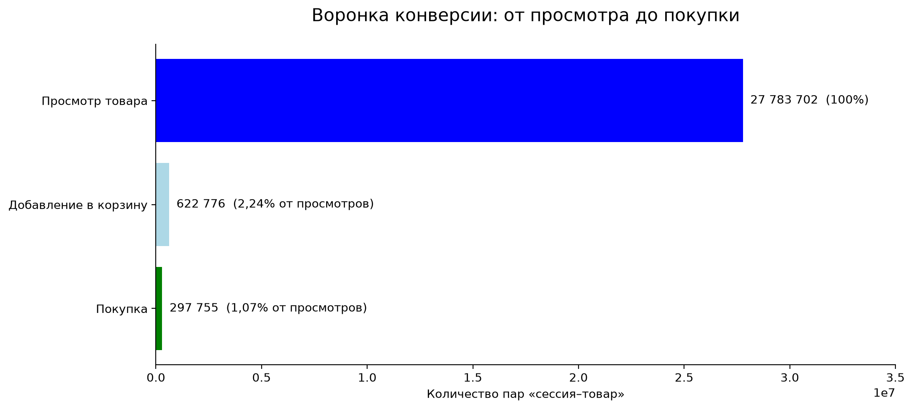
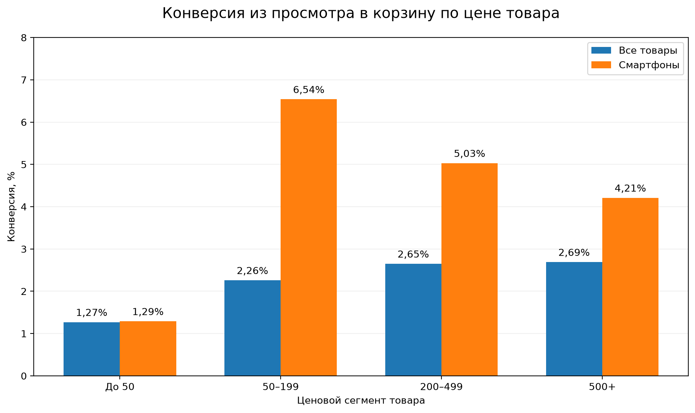

# Анализ продуктовой воронки интернет-магазина

Стек: PostgreSQL 18, SQL, Python (Matplotlib)

## О проекте

Продуктовое исследование пользовательского поведения на основе 42,4 млн событий интернет-магазина за октябрь 2019 года

Цель: определить основные потери в воронке просмотра, добавления в корзину и покупки, изучить связь конверсии с ценой товара

## Данные

Источник: Kaggle — eCommerce behavior data from multi-category store
События: view, cart, purchase
Единица анализа — пара «сессия–товар», этапы воронки учитываются в хронологическом порядке

## Результаты

### 1. Основная воронка

- Просмотр: 27 783 702 пар «сессия–товар»
- Просмотр → корзина: 622 776 (2,24%)
- Полная воронка до покупки: 297 755 (1,07%)
- Конверсия корзина → покупка среди прошедших предыдущий этап: 47,81%

Основные потери наблюдаются между просмотром товара и добавлением в корзину

### 2. Конверсия по цене товара

По всему ассортименту конверсия из просмотра в корзину увеличивается от 1,27% для товаров дешевле 50 до 2,69% для товаров от 500

В категории смартфонов среди товаров стоимостью от 50 наблюдается обратная тенденция: конверсия снижается с 6,54% до 4,21% по мере увеличения ценового сегмента

Вывод: агрегированные показатели могут скрывать различия между товарными категориями

## Продуктовые гипотезы

1. Низкая конверсия из просмотра в корзину может быть связана с особенностями товарных предложений или пользовательского намерения
2. Покупатели смартфонов разных ценовых сегментов могут демонстрировать различные сценарии выбора

Для проверки гипотез необходимы дополнительные исследования и эксперименты

## Ограничения

- Анализ охватывает только октябрь 2019 года
- Конверсия рассчитана на уровне пары «сессия–товар», а не уникальных пользователей
- Примерно 31,84% событий не содержат `category_code`
- Ценовые сегменты определены по средней цене просмотров товара в сессии
- Наблюдаемые зависимости не доказывают причинно-следственную связь

## Структура проекта

- `sql/01_product_funnel.sql` — основная воронка
- `sql/02_price_segments.sql` — анализ ценовых сегментов
- `sql/03_smartphone_analysis.sql` — анализ смартфонов
- `scripts/` — Python-скрипты визуализации
- `visuals/` — графики исследования

## Итог

Исследование выявило этап с наибольшими относительными потерями воронки и показало важность сегментного анализа для интерпретации продуктовых метрик